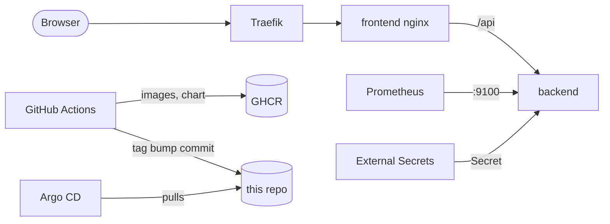

# Aspecta: Kubernetes environment for a small web app

NestJS API + React SPA on a local kind cluster. Argo CD deploys everything from this repo,
GitHub Actions builds the images and bumps the chart, kube-prometheus-stack does monitoring.



## Run it

You need docker, kind (0.31+), kubectl, helm 4, make and openssl. On Windows use WSL2.
Ports 80/443 must be free and Docker needs about 8 GB RAM (the cluster uses ~7 GB).

```bash
make up       # kind + Calico + Argo CD, then Argo CD installs the rest (~5 min)
make status   # wait until all apps are Synced/Healthy
make down     # delete the cluster
```

The app runs at http://aspecta.localtest.me (`*.localtest.me` resolves to 127.0.0.1).
Argo CD, Grafana, Prometheus and Alertmanager are on `argocd.`, `grafana.`, `prometheus.` and `alertmanager.localtest.me`.
Passwords: `make argocd-password`, `make grafana-password` (user `admin`).

Running from a fork: `make set-repo REPO=<owner>/<repo>`, push, run the `ci` workflow once by hand,
then make the three GHCR packages public (new packages are private and the cluster has no pull secret).

## Check that it works

```bash
make demo-netpol   # default ns -> backend blocked, frontend -> backend allowed, frontend -> metrics port blocked
make demo-rbac     # what the viewer and operator groups can and cannot do
make demo-secret   # ESO synced the token; /api/admin/stats returns 401 without it, 200 with it
make demo-alert    # 5xx burst -> WebappHighErrorRate fires in ~3 min and reaches the webhook
```

## How the assignment points map to the repo

- Architecture: one Helm chart for both apps with Deployments, ClusterIP Services, one Ingress, ConfigMaps, HPA, PDB ([charts/webapp](charts/webapp)).
- Security: PSA `restricted`, default-deny NetworkPolicies with explicit allows, two namespaced Roles, Argo CD project that cannot deploy a `Secret` ([templates/security](charts/webapp/templates/security), [gitops/projects](gitops/projects)).
- GitOps: Argo CD app-of-apps with sync waves, automated sync with prune and self-heal ([gitops](gitops)).
- CI/CD: test, multi-arch build, Trivy, push to GHCR, chart bump, `helm push`, commit back to git ([ci.yaml](.github/workflows/ci.yaml)); chart lint + kubeconform on chart changes.
- Monitoring: ServiceMonitor on a separate metrics port, 8 alerts with [runbooks](docs/alerts.md), Grafana dashboard "Aspecta / webapp", Alertmanager to a webhook.

## Decisions worth explaining

- kind + Calico. kindnet does not reliably enforce NetworkPolicy, so the policies would only be decoration.
- Traefik, not ingress-nginx. ingress-nginx was retired in March 2026. Traefik still serves plain `Ingress`, which the assignment asks for.
- External Secrets with the `kubernetes` provider. Sealed Secrets breaks on a fresh cluster (new key, old sealed values). Here `make up` generates the token into a `secrets-store` namespace that stands in for a vault; in production only the SecretStore provider changes.
- CI never touches the cluster. It writes to git and GHCR; Argo CD pulls. No cluster credentials in GitHub, every deploy is a commit, rollback is `git revert`.
- Metrics on their own port. Only Prometheus can reach 9100; the frontend and the Ingress cannot.
- HPA owns `replicas`. The Deployment has no `replicas` field, so Argo CD and the HPA do not fight.
- Traefik in the first sync wave. Argo CD marks an Ingress Healthy only when it has an address. Traefik publishes 127.0.0.1; if it came later, the monitoring Ingresses would block the next waves.

Known gap: the operator role can `patch` the two Deployments for `rollout restart`, and RBAC cannot limit which fields a patch changes. Argo CD self-heal reverts other changes. A ValidatingAdmissionPolicy would close it properly.

## What I would change for a real cluster

Managed CNI with NetworkPolicy (or Cilium) and default-deny in platform namespaces too, Gateway API + cert-manager,
ESO with Vault or a cloud secret manager and workload identity, self-managed Argo CD with SSO and a GitHub webhook,
a separate config repo with dev/stage/prod and promotion by PR, Kyverno + cosign for image policy,
SLO-based alerts to Slack/PagerDuty, Velero backups.

More detail: [architecture, diagrams and troubleshooting](docs/architecture.md), [alert runbooks](docs/alerts.md).
