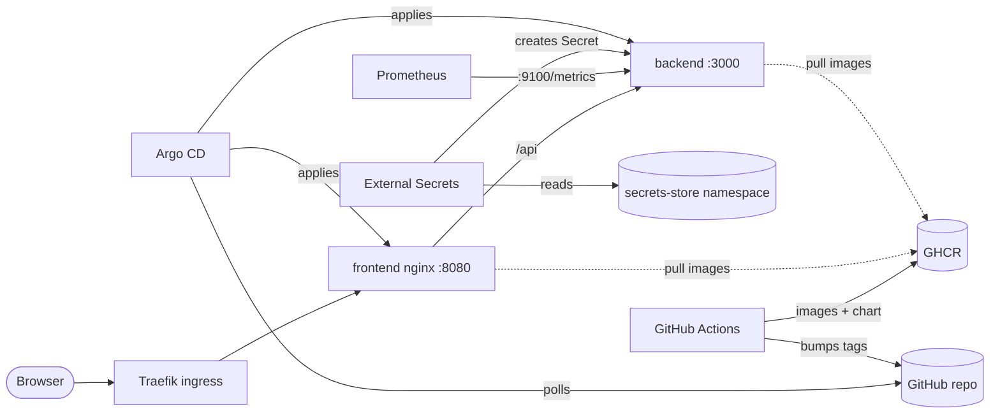
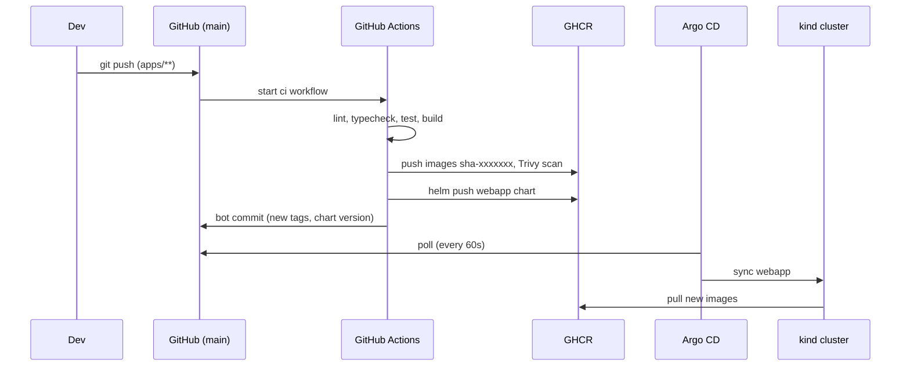

# Aspecta – Kubernetes production environment

A small web app (NestJS API + React SPA) running on a local kind cluster, set up the way I would run it in production.
Argo CD deploys everything from this repository. GitHub Actions builds and scans the images, pushes them to GHCR and commits the new tags back to git.
The app namespace runs with Pod Security `restricted`, default-deny NetworkPolicies, namespaced RBAC and secrets from External Secrets.
Prometheus, Alertmanager and Grafana come from kube-prometheus-stack, with app alerts and runbooks.

All names, ports and flows are defined in [docs/contracts.md](docs/contracts.md). More diagrams and design notes are in [docs/architecture.md](docs/architecture.md).

## Requirements coverage

| Assignment point | How it is solved | Main files |
|---|---|---|
| 1 Architecture | Deployments, ClusterIP Services and one Ingress for both apps; ConfigMaps for config, Secret from ESO for the admin token; one Helm chart; kind cluster | [charts/webapp](charts/webapp), [cluster/kind-config.yaml](cluster/kind-config.yaml) |
| 2 Security | Roles `webapp-viewer` / `webapp-operator`; default-deny NetworkPolicies with explicit allows; PSA `restricted`; Argo CD AppProject limits | [rbac.yaml](charts/webapp/templates/security/rbac.yaml), [networkpolicies.yaml](charts/webapp/templates/security/networkpolicies.yaml), [gitops/projects](gitops/projects) |
| 3 GitOps | Argo CD app-of-apps with sync waves; every change in git is synced automatically (prune + self-heal) | [gitops/root-app.yaml](gitops/root-app.yaml), [gitops/apps](gitops/apps) |
| 4 CI/CD | GitHub Actions: test, multi-arch image build, Trivy scan, push to GHCR, chart version bump, `helm package` + `helm push`, commit back to git | [ci.yaml](.github/workflows/ci.yaml), [bump-chart.sh](scripts/ci/bump-chart.sh) |
| 5 Monitoring | kube-prometheus-stack; ServiceMonitor for the backend metrics port; 8 app alerts; Alertmanager routes to a webhook; Grafana dashboard | [charts/webapp/templates/monitoring](charts/webapp/templates/monitoring), [kube-prometheus-stack.yaml](gitops/apps/kube-prometheus-stack.yaml) |
| 6 Documentation | This README, architecture notes, alert runbooks, contracts | [docs](docs) |

## Architecture



Details: [docs/architecture.md](docs/architecture.md).

## Technology choices

| Choice | Why | Alternative |
|---|---|---|
| kind + Calico | Multi-node cluster in Docker; Calico enforces NetworkPolicy (kindnet does not do it reliably) | minikube, k3d |
| Traefik | Supports standard `Ingress`; ingress-nginx was retired in March 2026 | Gateway API implementation (Envoy Gateway, Cilium) |
| Helm | One chart for both apps, values schema, easy to package and push as OCI | Kustomize |
| Argo CD | App-of-apps, sync waves between platform and app, clear UI for reviewers | Flux |
| GitHub Actions + GHCR | Code, CI and registry in one place; `GITHUB_TOKEN` is enough, no extra secrets | GitLab CI, Docker Hub |
| External Secrets | No secrets in git; works on a fresh cluster with the `kubernetes` provider; production only swaps the provider | Sealed Secrets, SOPS |
| kube-prometheus-stack | Prometheus, Alertmanager, Grafana and kube-state-metrics with operator CRDs in one chart | Grafana Alloy + Mimir |
| NestJS + React | Small, typed apps with real health, metrics and shutdown behavior to show the platform features | any HTTP app |

## Prerequisites

- docker, kind >= 0.31, kubectl, helm 4 (same major as CI), make, openssl, curl
- Windows: run everything in WSL2 with Docker Desktop (WSL integration on)
- Ports 80 and 443 on 127.0.0.1 must be free
- At least 8 GB RAM for Docker (the three kind nodes use about 7 GB after a full sync, measured with `docker stats`)

## Quick start

1. **Fork and point the repo to your fork.** Argo CD, the chart and CI must use your GitHub repo and GHCR owner:
   ```bash
   make set-repo REPO=<owner>/<repo>
   git commit -am "chore: point to <owner>/<repo>" && git push
   ```
   On a fork, enable GitHub Actions in the "Actions" tab first.
2. **Run CI once.** The push starts the `ci` workflow only when app files change, so start it by hand: Actions -> `ci` -> "Run workflow". It builds both images, pushes them and commits `chore(release): webapp <version>`. Then open your GitHub profile -> Packages and set `aspecta-backend`, `aspecta-frontend` and `charts/webapp` to **public** (one time; new GHCR packages are private and the cluster has no pull secret).
3. **Create the environment:**
   ```bash
   make up
   ```
   This creates the kind cluster, installs Calico and Argo CD, creates the source secrets and applies the root app. Argo CD installs the rest.
4. **Wait until all apps are Synced/Healthy** (about 5 minutes on first start):
   ```bash
   make status
   ```

`make down` deletes the cluster.

## URLs and credentials

| URL | What | Login |
|---|---|---|
| http://aspecta.localtest.me | Web app | - |
| http://argocd.localtest.me | Argo CD | `admin` / `make argocd-password` |
| http://grafana.localtest.me | Grafana | `admin` / `make grafana-password` |
| http://prometheus.localtest.me | Prometheus | - |
| http://alertmanager.localtest.me | Alertmanager | - |

`*.localtest.me` resolves to 127.0.0.1 in public DNS, so no hosts file changes are needed.

## Usage and demos

Run `make help` for all targets.

- `make demo-netpol` – four requests. A pod in `default` -> backend: **blocked**. Frontend -> backend:3000: **allowed** (JSON from `/api/info`). Frontend -> backend:9100: **blocked**. Host -> app through Traefik: **allowed**.
- `make demo-rbac` – `kubectl auth can-i` for user `jane` (group `webapp-viewers`) and `joe` (group `webapp-operators`). Viewer: only `get pods` is `yes`. Operator: also `patch deployments/webapp-backend` and `delete pods`. Both: `no` for secrets and `pods/exec`.
- `make demo-secret` – shows the SecretStore and ExternalSecret (`SecretSynced`), then calls `/api/admin/stats`: **401** without token, **200** with the token from the synced Secret.
- `make rotate-secret` – writes a new token to the source secret. ESO updates `webapp-backend-secrets` within 1 minute; after `kubectl rollout restart -n webapp deploy/webapp-backend` only the new token works.
- `make demo-alert` – sends 300 requests to `/api/chaos/error` (enabled in `values-kind.yaml`). `WebappHighErrorRate` fires after 2–3 minutes and shows up in Prometheus, Alertmanager and `kubectl logs -n monitoring deploy/alert-webhook`.
- `make admin-token` – prints the current token from the source secret.

## CI/CD

1. A push to `main` that changes `apps/backend/**` or `apps/frontend/**` (or "Run workflow") starts [ci.yaml](.github/workflows/ci.yaml).
2. For each changed app: `npm ci`, lint, typecheck, tests, multi-arch image build with `APP_VERSION=sha-xxxxxxx`, push to GHCR, Trivy scan (fails on fixable CRITICAL findings).
3. `release-chart` runs when at least one app job passed and none failed: [bump-chart.sh](scripts/ci/bump-chart.sh) sets the new image tags and bumps the chart patch version, then `helm lint`, `helm package`, `helm push` to `oci://ghcr.io/marekz98/charts`, and a bot commit `chore(release): webapp <version> [skip ci]`.
4. Argo CD sees the new commit within about 1 minute and rolls out the new images.

Pull requests run tests and an amd64 image build without push.



**Why CI has no cluster access:** this is the pull model. CI only writes to git and GHCR; Argo CD inside the cluster pulls the change. There are no cluster credentials in GitHub, git is the audit log of every deploy, and a rollback is a `git revert`. It also works for a local cluster that GitHub cannot reach. Argo CD deploys the chart from git (`charts/webapp`), so every deploy is a visible commit; the OCI chart in GHCR is the versioned release artifact for other consumers.

## GitOps

`make up` applies only the AppProjects and the root app. The root app `root` reads `gitops/projects/*.yaml` and `gitops/apps/*.yaml` and creates the child apps. All apps use automated sync with `prune` and `selfHeal` and retry with backoff.

| Wave | Apps | Why this order |
|---|---|---|
| -2 | `metrics-server`, `external-secrets`, `kube-prometheus-stack`, `traefik` | CRDs, HPA metrics and the ingress controller (it must exist before any Ingress, or Ingress health never turns Healthy) |
| -1 | `alert-webhook`, `secrets-store-rbac` | alert receiver, RBAC for ESO |
| 1 | `webapp` | the app chart (`values.yaml` + `values-kind.yaml`) |

Two projects keep the blast radius small: `platform` for the shared components and `webapp`, which may deploy only to namespace `webapp` and only a fixed list of kinds.

**Change config:** edit `charts/webapp/values*.yaml` (for example `GREETING`), commit and push. Argo CD syncs in about 1 minute and the ConfigMap change triggers a rollout (checksum annotation).

**Self-heal demo:**
```bash
kubectl delete networkpolicy default-deny-all -n webapp
kubectl get networkpolicy -n webapp -w   # Argo CD recreates it within seconds
```
`kubectl scale deploy/webapp-backend --replicas=5` is different: the Deployment has no `replicas` field (the HPA owns it), so Argo CD does not see drift and the HPA scales back to its target.

## Security

- **Pod Security:** namespaces `webapp` and `secrets-store` enforce PSA `restricted`. Pods run as non-root (backend `1000`, frontend `101`), seccomp `RuntimeDefault`, no privilege escalation, all capabilities dropped, read-only root filesystem with only `/tmp` writable.
- **RBAC:** Role `webapp-viewer` (group `webapp-viewers`) can read workloads, logs and network objects, not secrets. Role `webapp-operator` (group `webapp-operators`) adds rollout restart and scale on the two Deployments (limited by `resourceNames`) and pod delete. No `pods/exec`, no secrets. Workload ServiceAccounts do not mount a token. Demo: `make demo-rbac`.
- **Remaining risk:** RBAC cannot limit which fields a `patch` changes, so an operator could change the pod spec of the two Deployments. Argo CD self-heal reverts such a change, and PSA `restricted` blocks privileged pods in the meantime.
- **NetworkPolicy** (namespace `webapp`, demo: `make demo-netpol`):

  | Policy | Selects | Allows |
  |---|---|---|
  | `default-deny-all` | all pods | nothing (Ingress + Egress) |
  | `allow-dns-egress` | all pods | egress UDP/TCP 53 to `kube-dns` in `kube-system` |
  | `frontend-ingress` | frontend | ingress TCP 8080 from namespace `traefik` |
  | `frontend-egress` | frontend | egress TCP 3000 to backend |
  | `backend-ingress` | backend | ingress TCP 3000 from frontend; TCP 9100 from Prometheus in `monitoring` |

- **Argo CD AppProject `webapp`:** one source repo, one destination namespace, a whitelist of kinds. `Secret` is not on the list, so a Secret can never come from git.
- **Secrets:** `bootstrap.sh` generates the admin token into namespace `secrets-store` (a stand-in for a vault). ESO copies it into `webapp-backend-secrets` with a ServiceAccount that may only read that namespace. Nothing secret is in git. See [secrets flow](docs/architecture.md#secrets-flow).
- **Supply chain:** all GitHub Actions are pinned by commit SHA, all images and charts by version. Trivy blocks images with fixable CRITICAL CVEs. Images are built with SBOM and provenance.
- **Guardrails:** ResourceQuota and LimitRange in `webapp`; PodDisruptionBudgets and topology spread for both apps.

## Monitoring and alerting

- Prometheus scrapes the backend on its separate metrics port 9100 (ServiceMonitor `webapp-backend`): `http_requests_total`, `http_request_duration_seconds` and default Node.js metrics. kube-state-metrics, kubelet/cAdvisor and node-exporter cover pods and nodes.
- Grafana dashboard **"Aspecta / webapp"**: error ratio, ready pods, restarts, request rate, latency p50/p95/p99, requests by route, CPU and memory per pod.
- Alertmanager sends every alert (and the resolve) to the `alert-webhook` echo server in `monitoring`. `Watchdog` goes to `null`.

| Alert | Meaning | Severity |
|---|---|---|
| [WebappBackendDown](docs/alerts.md#webappbackenddown) | no backend target is up | critical |
| [WebappHighErrorRate](docs/alerts.md#webapphigherrorrate) | more than 5% of requests return 5xx | warning |
| [WebappHighLatencyP95](docs/alerts.md#webapphighlatencyp95) | p95 latency above 500 ms | warning |
| [WebappPodCrashLooping](docs/alerts.md#webapppodcrashlooping) | more than 3 restarts in 15 minutes | warning |
| [WebappPodNotReady](docs/alerts.md#webapppodnotready) | a pod is not ready for 5 minutes | warning |
| [WebappDeploymentReplicasMismatch](docs/alerts.md#webappdeploymentreplicasmismatch) | available replicas differ from desired for 10 minutes | warning |
| [WebappHPAMaxedOut](docs/alerts.md#webapphpamaxedout) | an HPA is at max replicas for 15 minutes | info |
| [WebappContainerMemoryNearLimit](docs/alerts.md#webappcontainermemorynearlimit) | a container uses more than 90% of its memory limit | warning |

**Test alert:** `make demo-alert`, or `curl "http://aspecta.localtest.me/api/chaos/slow?ms=2000"` in a loop for `WebappHighLatencyP95`.

## Repository layout

```text
apps/backend/          NestJS API (health, metrics, admin and chaos endpoints)
apps/frontend/         React SPA, served by unprivileged nginx
charts/webapp/         Helm chart: apps, RBAC, NetworkPolicies, ESO, monitoring
cluster/               kind config, Calico and Argo CD Helm values
gitops/projects/       Argo CD AppProjects (platform, webapp)
gitops/apps/           child apps created by the root app
gitops/platform/       plain manifests: alert webhook, secrets-store RBAC
gitops/root-app.yaml   app-of-apps entry point
scripts/bootstrap.sh   creates the local environment (make up)
scripts/set-repo.sh    rewrites repo and GHCR references for forks
scripts/ci/            CI helper (chart bump)
.github/workflows/     ci.yaml (build and release), chart-lint.yaml (lint + kubeconform)
docs/                  contracts, architecture, alert runbooks
```

## Troubleshooting

- **Port 80 or 443 in use:** `kind create cluster` fails. Stop the other web server or Docker container (`docker ps`, `sudo ss -ltnp 'sport = :80'`) and run `make up` again.
- **`ImagePullBackOff` in `webapp`:** CI has not run yet (tags are still `0.1.0`), or the GHCR packages are private. Run the `ci` workflow, make the packages public, then `kubectl delete pod -n webapp --all`.
- **App stuck in sync waves:** look at the `root` app first (`kubectl get applications -n argocd`, Argo CD UI). A wave waits until all apps of the previous wave are Healthy; a failing platform app blocks `webapp`.
- **ExternalSecret `SecretSyncedError`:** check that `secrets-store-rbac` is Synced and that Role `eso-reader` and its RoleBinding exist in `secrets-store` (`kubectl get role,rolebinding -n secrets-store`), and that the source secret exists (`kubectl get secret webapp-backend -n secrets-store`).
- **WSL clock drift** (TLS or token errors after the laptop sleeps): run `sudo hwclock -s` in WSL or `wsl --shutdown` in Windows.

## Production notes

What I would change for EKS, GKE or AKS:

- **Network:** managed CNI with NetworkPolicy support (or Cilium); default-deny also in platform namespaces.
- **Ingress:** Gateway API instead of Ingress; cert-manager with real TLS certificates.
- **Secrets:** ESO with Vault or AWS Secrets Manager / GCP Secret Manager and workload identity instead of the `kubernetes` provider.
- **Argo CD:** self-managed, with SSO and Argo CD RBAC, and a webhook from GitHub instead of polling.
- **Environments:** separate config repo with dev/stage/prod overlays and promotion by pull request; Argo CD Image Updater as an alternative to the bot commit.
- **Policy:** Kyverno for image signature checks and security rules; images signed with cosign. A ValidatingAdmissionPolicy that allows the operator group to change only the `kubectl.kubernetes.io/restartedAt` annotation on the Deployments would close the patch gap described in Security.
- **Alerting:** Alertmanager to Slack and PagerDuty; SLO-based burn-rate alerts instead of fixed thresholds.
- **Backups:** Velero for cluster state and volumes.
