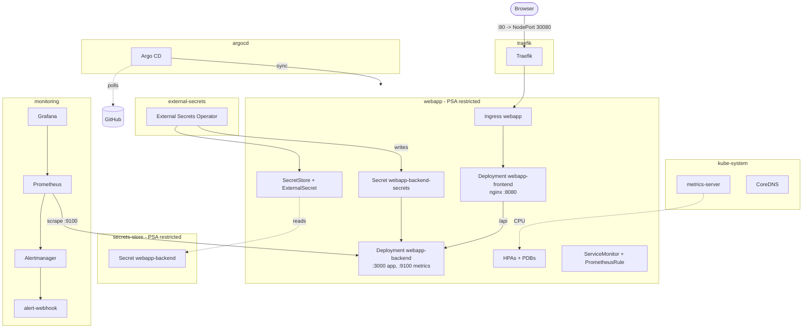
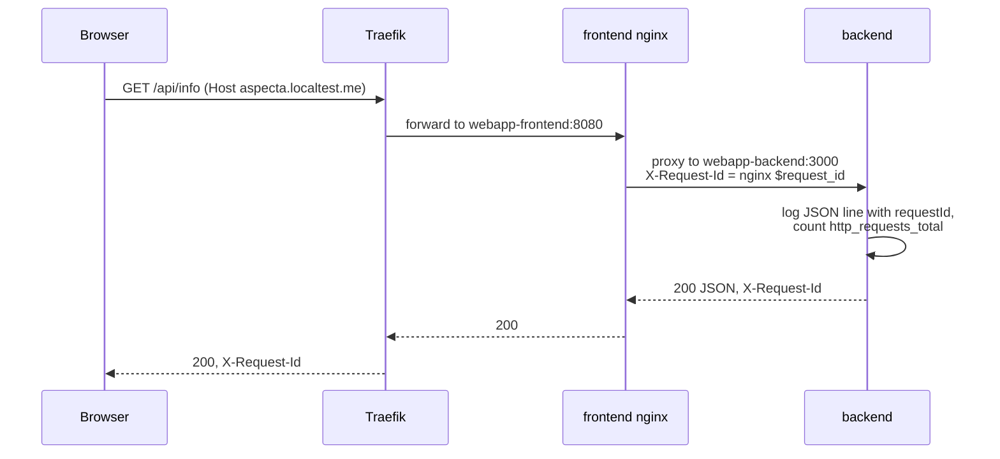
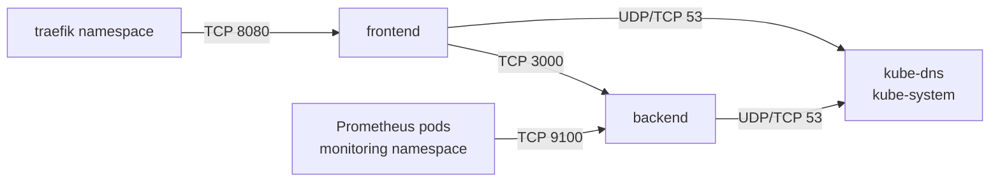
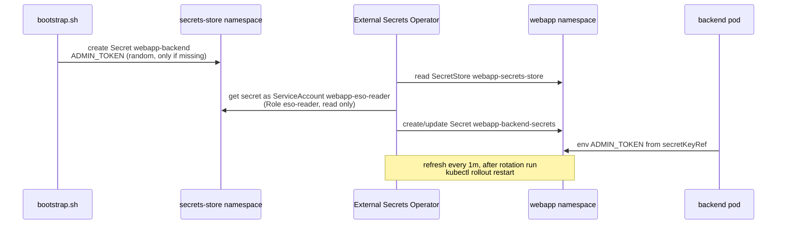
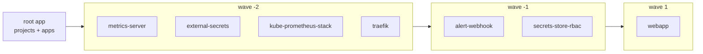

# Architecture

Names and ports in this file come from [contracts.md](contracts.md).

## Components

## Request flow

The frontend nginx is the only public entry. It serves the SPA and proxies `/api/` to the backend Service.
nginx sets `X-Request-Id` to its own `$request_id`; the backend reuses it in its logs and returns it in the response, so one ID links the nginx access log and the backend log line.

## NetworkPolicies

Namespace `webapp` starts with `default-deny-all` for ingress and egress. Only the edges below are allowed (label = port).

The backend has no egress except DNS. Kubelet probes still work because Calico allows traffic from the node to its local pods.

## Secrets flow

ESO requests a short-lived token for `webapp-eso-reader`, so the ServiceAccount itself does not mount a token. In production only the SecretStore provider changes.

## Argo CD sync waves

Argo CD has a health check for `Application`, so a wave waits until the apps of the previous wave are Healthy.
Chart objects that use CRDs from wave -2 also have `SkipDryRunOnMissingResource=true`, as a second safety net.

Traefik is in wave -2 on purpose. Argo CD reports an Ingress as Healthy only when its status has an address.
With a NodePort Service there is no load balancer address, so Traefik publishes `127.0.0.1` (the address kind maps to the host).
If Traefik came after kube-prometheus-stack, the Grafana/Prometheus Ingresses would stay Progressing and block the next waves.

## Design decisions

**Separate metrics port.** The backend serves `/metrics` on its own Node HTTP server on port 9100. The Ingress and the nginx proxy only know port 3000, so metrics can never leak to the internet, and the NetworkPolicy can allow 9100 only from Prometheus. It also keeps the metrics endpoint out of the request metrics.

**nginx proxies `/api`.** The browser talks to one origin, so there is no CORS setup and the backend is not public at all. The frontend is the only thing behind the Ingress. The nginx config that does the proxying lives in the chart ConfigMap; the image itself only serves the SPA, so it can run standalone.

**HPA owns replicas.** When autoscaling is on, the Deployment has no `replicas` field. Otherwise every Argo CD sync would reset the replica count and fight the HPA. The cost: `kubectl scale` is not drift for Argo CD, the HPA corrects it instead.

**Chart in the app repo.** App code, chart and GitOps config are in one repository. This is simple for one app and one environment, and a reviewer sees everything in one place. The trade-off: CI writes bot commits to the same repo, and access to config and code is the same. With several environments I would move the GitOps config to a separate repo and promote by pull request.

**Argo CD is not self-managed.** `bootstrap.sh` installs Argo CD with Helm and Argo CD then manages everything else. Self-management adds a bootstrap loop (Argo CD syncing its own deployment) that brings little value for a local cluster that is rebuilt with `make up`. In production I would let Argo CD manage itself.

**Polling instead of webhook.** GitHub cannot reach a kind cluster on a laptop, so Argo CD polls git every 60 seconds. A deploy takes about one minute longer than with a webhook, which is fine here. In production a GitHub webhook to Argo CD removes the delay.
