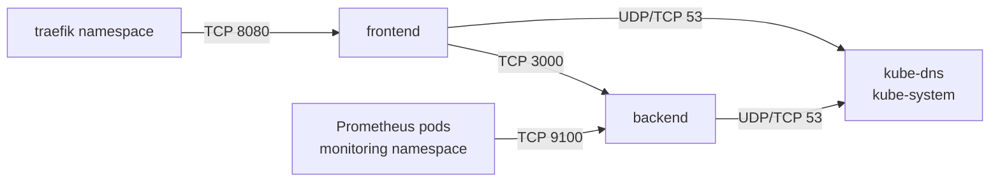
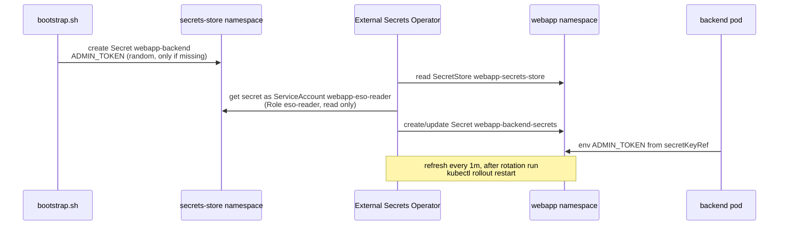
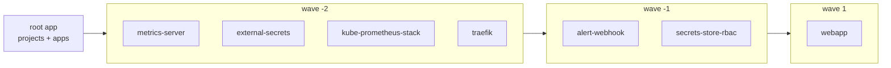

# Architecture

## Components

The frontend nginx is the only thing behind the Ingress. It serves the SPA and proxies `/api/` to the backend,
so there is no CORS and the backend is not public. nginx passes its `$request_id` as `X-Request-Id`, and the backend
logs it, so one ID links both log lines.

## NetworkPolicies

Namespace `webapp` starts with `default-deny-all` for ingress and egress. Only the edges below are allowed (label = port).

The backend has no egress except DNS. Kubelet probes still work because Calico allows traffic from the node to its local pods.

## Secrets flow

ESO requests a short-lived token for `webapp-eso-reader`, so the ServiceAccount itself does not mount a token. In production only the SecretStore provider changes.

## Argo CD sync waves

Argo CD has a health check for `Application`, so a wave waits until the apps of the previous wave are Healthy.
Chart objects that use CRDs from wave -2 also have `SkipDryRunOnMissingResource=true`, as a second safety net.

Traefik is in wave -2 on purpose. Argo CD reports an Ingress as Healthy only when its status has an address.
With a NodePort Service there is no load balancer address, so Traefik publishes `127.0.0.1` (the address kind maps to the host).
If Traefik came after kube-prometheus-stack, the Grafana/Prometheus Ingresses would stay Progressing and block the next waves.

## Smaller decisions

- Chart and GitOps config live in the app repo. Simple for one app and one environment, and everything is in one place. With more environments I would move GitOps config to its own repo and promote by pull request.
- Argo CD is not self-managed. `bootstrap.sh` installs it with Helm. Self-management adds a bootstrap loop that brings little for a cluster rebuilt with `make up`.
- Polling, not a webhook. GitHub cannot reach a kind cluster on a laptop, so Argo CD polls every 60 s.

## Troubleshooting

- Port 80 or 443 in use: `kind create cluster` fails. Stop the other web server or container (`docker ps`, `sudo ss -ltnp 'sport = :80'`) and run `make up` again.
- `ImagePullBackOff` in `webapp`: CI has not run yet, or the GHCR packages are private. Run the `ci` workflow, make the packages public, then `kubectl delete pod -n webapp --all`.
- App stuck in sync waves: look at the `root` app first. A wave waits until all apps of the previous wave are Healthy, so one failing platform app blocks `webapp`.
- ExternalSecret `SecretSyncedError`: check that `secrets-store-rbac` is Synced, that Role `eso-reader` and its RoleBinding exist in `secrets-store`, and that the source secret `webapp-backend` exists there.
- WSL clock drift (TLS or token errors after the laptop sleeps): `sudo hwclock -s` in WSL or `wsl --shutdown` in Windows.
